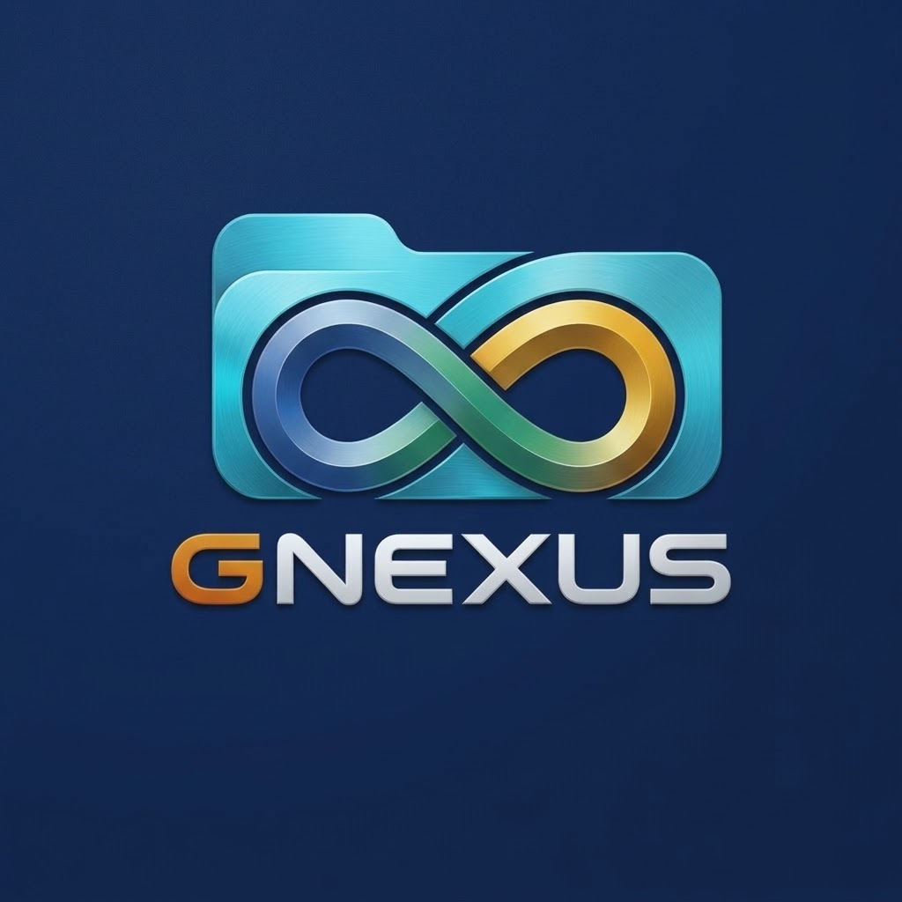

<h1 align="center">G Nexus</h1>

<b>Google Drive Migration Engine</b>

G Nexus is a Windows app that makes a full local backup of the Google Drive of several
Google Workspace accounts, for example before the accounts are deleted or moved.
It only copies. Nothing is ever changed or deleted on Google Drive.

It uses [rclone](https://rclone.org) for the transfers and adds a simple window on top:
a dashboard with one card per account, live progress, a byte-by-byte check, and logs you
can send to support.

## What it backs up

- **My Drive**
- **Shared with me** (all of it, or only files owned by people outside your accounts)
- **Shared drives**
- **Trash** (optional)

Google Docs, Sheets and Slides are saved as Office files (or OpenDocument or PDF, which you
choose in Settings). Mac system files (`._name`, `.DS_Store`, `__MACOSX`) are skipped by default.

## Features

- Dashboard with a card per account: sign-in status, size on Drive, downloaded, files, verified
- Pick which parts to download (My Drive, Shared with me, Shared drives, Trash)
- Verify after download: compares size and MD5 of every file with Google Drive
- SHA-256 checksum list to check a copy later
- Checks that every sign-in is the right email
- Free-space check before downloading, speed limit, parallel downloads
- Stop and skip buttons, and protection against two backups running at once
- "Report for support" zip with logs and no passwords or tokens
- Accounts and settings in plain files, so you can reuse it for another organization

## Requirements

- Windows 10 or 11 (PowerShell 5.1 is built in)
- rclone: `winget install Rclone.Rclone`
- Your own Google Cloud OAuth client (Desktop app), about 10 minutes to set up.
  Without it rclone's shared app hits Google's "Quota exceeded" limits.

## Getting started

1. Download or clone this repository into a folder.
2. Double-click **G Nexus.bat**. On the first run it asks for the backup folder. Everything
   G Nexus makes goes there: the backups, `_logs`, and `_gnexus` (settings, accounts, session),
   so the app folder stays clean.
3. Open **Settings** and paste your Google app's Client ID and Client secret.
4. Add your accounts with **Accounts > Add** (or edit `accounts.csv`).
5. Press **Sign in all that need it**, then select accounts and press **Download**.

The full step-by-step guide, including how to create the Google app, is in
[INSTRUCTIONS.md](INSTRUCTIONS.md) and under **Help** in the app.

## Files

| File | What it is |
|---|---|
| `G Nexus.bat` / `Backup.bat` | Opens the app |
| `backup-app.ps1` | The window (WinForms) |
| `backup-drive.ps1` | The engine: sign-in, sizes, download, verify (also usable as a text menu) |
| `Backup-console.bat` | Opens the text menu |
| `INSTRUCTIONS.md` | Step-by-step guide (also under **Help** in the app) |
| `Stop all backups.bat`, `stop-all.ps1` | Stops every running backup |
| `accounts.example.csv` | Template for `_gnexus\accounts.csv`: Name, Email, Password, Folder |
| `settings.example.json` | Template for `_gnexus\settings.json` |
| `gnexus-*.png`, `gnexus.ico` | Logo and icon |

## Privacy

`accounts.csv` (which can hold password reminders), `settings.json` (your Google app's
secret), the backups and the logs live in the backup folder you choose, not in the app
folder, so they never end up in Git. `.gitignore` blocks them anyway.
Google sign-in tokens are kept by rclone in its own config file in your user profile,
never in this folder.

## Limits

Google Forms, Sites, My Maps and Jamboard can't be exported by any tool. Version history
and comments are not saved, only the latest version of each file.

## License

MIT, see [LICENSE](LICENSE).
